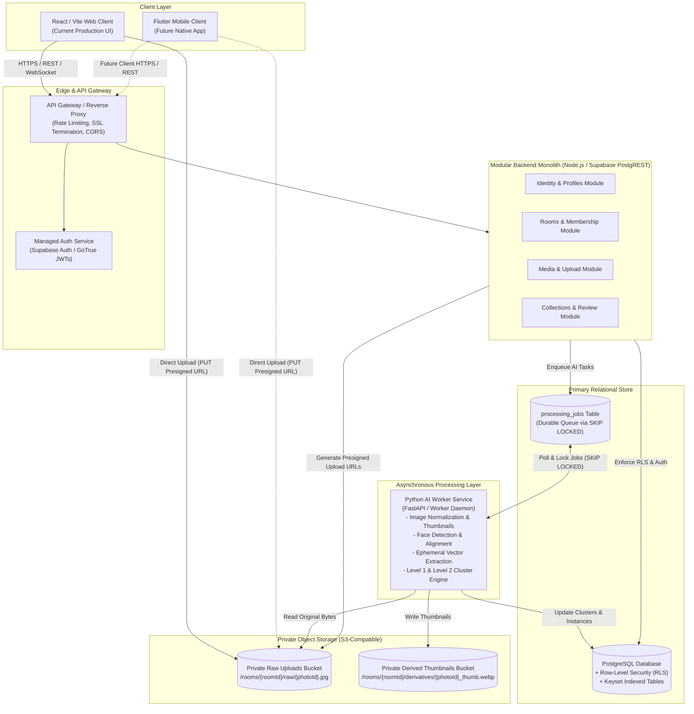
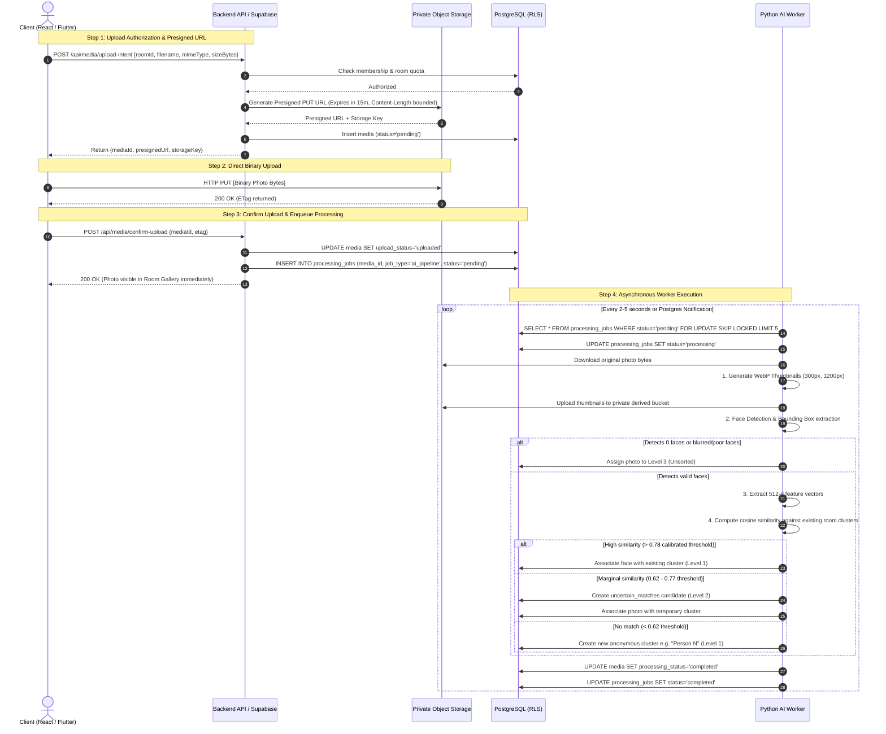
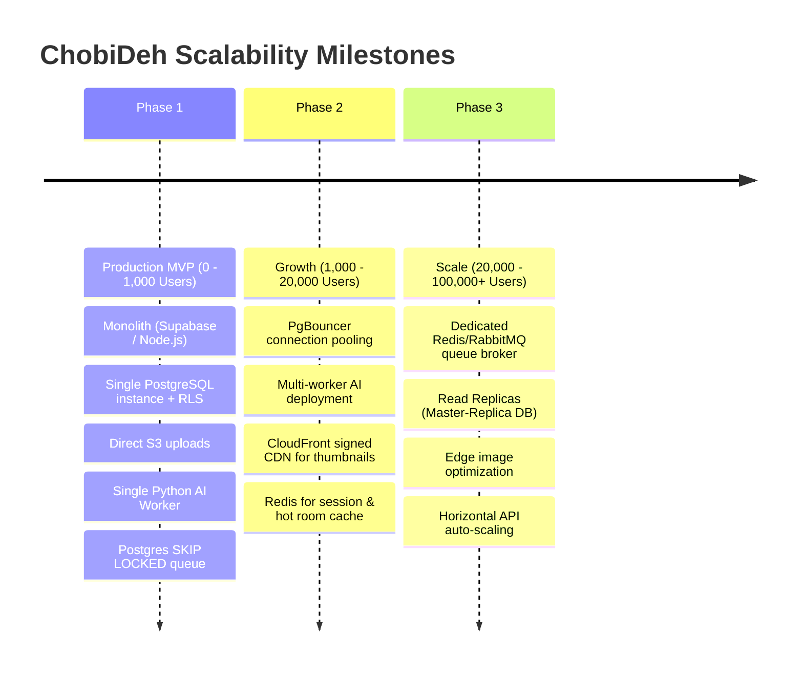

# ChobiDeh — Scalable Architecture Plan (Production-Oriented MVP)

> **Document Status:** PROPOSED ARCHITECTURE FOR REVIEW  
> **Author:** Architecture & System Design Agent  
> **Date:** October 20, 2026  
> **Theoretical Foundation:** Informed by the [System Design Primer](https://github.com/donnemartin/system-design-primer) (Donne Martin)

---

## 1. Executive Summary & Product Scope

ChobiDeh is a privacy-first, room-based collaborative photo organization application designed for events, trips, and social gatherings.

### Core Product Capabilities:
1. **Authentication & User Profiles:** Secure registration, session management, and privacy preferences without biometric enrollment.
2. **Private Rooms & Multi-Tenant Membership:** Ephemeral or persistent event vaults (e.g., "Cox's Bazar Tour") strictly isolated by cryptographic room codes and server-enforced access controls.
3. **Direct Photo Uploads & Galleries:** High-throughput photo uploads, timeline browsing, and full-resolution downloads.
4. **3-Level AI Face Clustering Pipeline:**
   - **Level 1 (Confident Clustering):** Automatic clustering of visually similar faces into anonymous room-level person collections (e.g., "Person 1", "Person 2") which members can rename.
   - **Level 2 (Uncertain Matches):** Potential merges and ambiguous faces presented to users for side-by-side review; **never merged automatically**.
   - **Level 3 (Unsorted):** Safe fallback repository for scenic shots, group panoramas, occluded faces, and photos without detectable faces.

### Primary Architecture Objective:
Transition the current working React/Vite client to a scalable, cost-efficient, production-grade backend that:
- Supports both the current React web client and a future Flutter native mobile client without API rewrites.
- Starts as a **modular monolith using managed services** (PostgreSQL + RLS, Supabase Auth, S3-compatible private object storage, and a decoupled Python AI worker).
- Strictly follows the **System Design Primer** guidelines: no premature distributed systems (no Redis, Kafka, or Kubernetes at Day 1), explicit bottlenecks triggering future upgrades, direct-to-storage uploads, cursor pagination, and asynchronous job processing.

---

## 2. System Design Primer Principles Applied to ChobiDeh

The table below maps core topics from Donne Martin's *System Design Primer* directly to ChobiDeh's architectural decisions:

| System Design Primer Topic | Core Primer Concept | ChobiDeh Application & Design Choice |
| :--- | :--- | :--- |
| **Performance vs. Scalability** | A service is *performant* if it serves requests fast; it is *scalable* if it handles increased workload smoothly. | Fast single-photo loads (<100ms via signed thumbnail URLs) while remaining scalable during sudden post-trip burst uploads (e.g., 200 photos dumped by 5 members simultaneously). |
| **Latency vs. Throughput** | Maximizing operations per second while minimizing turnaround time. | Photo uploads are decoupled from AI inference. Upload latency is low (<1s for metadata registration), while background worker throughput scales independently. |
| **Availability vs. Consistency (CAP)** | Trade-offs between Consistency, Availability, and Partition Tolerance. | **Room Access & Auth:** Strong Consistency (**CP**). Users must never access rooms or photos they were removed from.<br>**AI Clusters & Thumbnails:** Eventual Consistency (**AP**). Photos appear in the gallery immediately; face tags appear a few seconds later. |
| **Asynchronous Processing & Queues** | Offload compute-intensive tasks from the HTTP request-response cycle; decouple producers and consumers. | Web servers issue presigned S3 upload URLs and insert job records. A Python background worker processes jobs asynchronously using PostgreSQL `FOR UPDATE SKIP LOCKED`. |
| **Relational Database & Indexes** | B-tree indexing, query optimization, foreign keys, and ACID transactions. | PostgreSQL 16+ with Row-Level Security (RLS). B-tree compound indexes for timeline sorting `(room_id, created_at DESC)` and job polling `(status, attempt_count)`. |
| **Pagination Patterns** | Offset pagination (`LIMIT/OFFSET`) suffers from `O(N)` scan penalty on large datasets; Keyset pagination is `O(1)`. | **Keyset Pagination (Cursor-based):** Queries fetch records where `(created_at, id) < (cursor_created_at, cursor_id) ORDER BY created_at DESC, id DESC LIMIT 30`. |
| **Reverse Proxy & Gateway** | SSL termination, compression, routing, and rate limiting. | Supabase API Gateway / Kong handles SSL, CORS, request body limits, and token verification at the perimeter. |
| **Object Storage vs. Relational Blobs** | Store structured metadata in RDBMS; store unstructured binary objects in S3-compatible storage. | PostgreSQL stores metadata, bounding boxes, and cluster IDs; raw image bytes and WebP thumbnails reside in private S3 buckets. |
| **Security: Principle of Least Privilege** | Restrict entities to only the minimum permissions required. | Clients never access AWS/S3 master credentials. Access is mediated via short-lived (15–60 min) HMAC presigned URLs. Workers connect with role-restricted DB credentials. |

---

## 3. High-Level System Architecture



---

## 4. Evaluation of Initial Tech Stack (Supabase vs. Custom Node.js)

To determine the most pragmatic, production-oriented starting point without unnecessary overhead, we evaluated two architectural paths:

| Criterion | Option A: Supabase Managed Stack (Auth + PostgREST + RLS + Storage) | Option B: Custom Node.js/Express Monolith + Self-Managed DB & S3 |
| :--- | :--- | :--- |
| **Client Parity (React + Flutter)** | **Excellent:** Official high-quality SDKs exist for both React/Vite (web) and Flutter (mobile). Exact same client API calls and auth flows. | **Moderate:** Requires writing and maintaining custom client SDKs or API client libraries for both platforms. |
| **Multi-Tenant Room Isolation** | **Native via PostgreSQL RLS:** Database engine automatically enforces `WHERE room_id IN (SELECT room_id FROM room_members WHERE user_id = auth.uid())` on every query. Impossible for a developer to forget a room check in an endpoint. | **Manual Application Middleware:** Must manually check `req.user.rooms.includes(roomId)` on every single route. Higher risk of authorization bypass bugs. |
| **Time to Production MVP** | **High Velocity:** Auth, OAuth, sessions, database migrations, connection pooling, and storage signed URLs ready out-of-the-box. | **Lower Velocity:** Requires boilerplate for JWT issuance, token rotation, password hashing, mailer integration, and file streaming. |
| **Extensibility & AI Integration** | Can be paired with a lightweight Express/FastAPI service or webhook triggers for custom business logic and worker coordination. | Direct control over all middleware, routes, and daemon processes in a single codebase. |
| **Operational Overhead** | Low: Managed backups, automated SSL, zero server patch maintenance. | Moderate: Must manage server infrastructure, Docker containers, DB patching, and security updates. |

### Architectural Recommendation: **Hybrid Pragmatic Architecture**
- **Core Persistence & Auth:** Use **Supabase (PostgreSQL 16 + GoTrue Auth + Private Storage)** as the managed foundation.
- **Business Logic & AI Worker:** A lean, custom **Python AI Worker** running on a container instance that polls the database queue, executes face clustering, generates thumbnails, and updates the database.
- **Client Access:** Both React and Flutter talk to Supabase for Auth, standard data CRUD (safeguarded by RLS), and direct presigned storage uploads. High-level orchestrations (such as triggering a re-cluster or bulk merge) call custom RPCs or worker endpoints.

---

## 5. Module Boundaries & Responsibilities

To maintain clean separation of concerns and prevent spaghetti code, the system is divided into four distinct domain modules:

```
┌────────────────────────────────────────────────────────────────────────┐
│                        CHOBIDEH MODULAR DOMAINS                         │
├───────────────────┬───────────────────┬────────────────────────────────┤
│  1. IDENTITY      │  2. ROOMS         │  3. MEDIA                      │
│  - User profiles  │  - Room lifecycle │  - Presigned upload issuance   │
│  - Preferences    │  - Invite codes   │  - Storage key metadata        │
│  - Opt-out state  │  - Roles (Member) │  - Image dimension/size audits │
│  - Session tokens │  - Access checks  │  - Signed download URLs        │
├───────────────────┴───────────────────┴────────────────────────────────┤
│  4. AI PROCESSING & COLLECTIONS                                        │
│  - Background job orchestration (processing_jobs)                      │
│  - Thumbnail generation (WebP 300x300, 1200x1200)                      │
│  - Face detection & alignment (bounding box metadata)                  │
│  - Room-scoped face clustering (Level 1: Confident)                    │
│  - Review suggestion generation (Level 2: Uncertain)                   │
│  - Unsorted collection assignment (Level 3: Unsorted)                  │
│  - Biometric purge and cluster deletion                                │
└────────────────────────────────────────────────────────────────────────┘
```

1. **`identity` Module:**
   - Owns `users` and `user_preferences`.
   - Manages user profiles, authentication state, and clustering opt-out flags.
   - Enforces the strict rule: **No selfie or face template is ever stored in the user profile.**

2. **`rooms` Module:**
   - Owns `rooms` and `room_members`.
   - Handles room creation, membership verification, and joining via Argon2id-hashed invite codes (e.g., `CB-9821`).
   - Serves as the security boundary: every request must authenticate against this module.

3. **`media` Module:**
   - Owns the `media` table.
   - Issues presigned S3 upload URLs with restricted Content-Type and max length headers.
   - Verifies upload completion via checksums and dimensions before marking status as `uploaded`.

4. **`ai-processing & collections` Module:**
   - Owns `room_person_clusters`, `face_instances`, `uncertain_matches`, `photo_assignments`, and `processing_jobs`.
   - Executes image normalization, face detection, ephemeral vector extraction, similarity grouping, and user merge reviews.

---

## 6. Photo Upload & Background AI Processing Workflow

In accordance with the *System Design Primer* guidelines on **Latency vs. Throughput** and **Decoupling**:
- **Never stream large photo files through the API web server.** Direct client-to-storage upload prevents thread pool starvation and keeps memory footprints tiny.
- **Never run AI inference during the upload HTTP request.** AI processing is inherently CPU/GPU intensive and variable in duration (500ms to 5s per photo).

### Detailed Request Flow:



---

## 7. Database Model & Row-Level Security (RLS)

### Physical Schema & Table Definitions (PostgreSQL 16)

```sql
-- Enable necessary extensions
CREATE EXTENSION IF NOT EXISTS "uuid-ossp";
CREATE EXTENSION IF NOT EXISTS "pgcrypto";

-- 1. Profiles & Preferences
CREATE TABLE public.profiles (
    id UUID PRIMARY KEY REFERENCES auth.users(id) ON DELETE CASCADE,
    display_name TEXT NOT NULL CHECK (char_length(display_name) <= 50),
    avatar_url TEXT,
    face_clustering_enabled BOOLEAN NOT NULL DEFAULT TRUE,
    created_at TIMESTAMPTZ NOT NULL DEFAULT timezone('utc', now()),
    updated_at TIMESTAMPTZ NOT NULL DEFAULT timezone('utc', now())
);

-- 2. Rooms
CREATE TABLE public.rooms (
    id UUID PRIMARY KEY DEFAULT gen_random_uuid(),
    name TEXT NOT NULL CHECK (char_length(name) >= 2 AND char_length(name) <= 80),
    created_by UUID NOT NULL REFERENCES public.profiles(id),
    join_code_hash TEXT NOT NULL, -- Argon2id hash of room joining code (e.g. "CB-9821")
    created_at TIMESTAMPTZ NOT NULL DEFAULT timezone('utc', now()),
    deleted_at TIMESTAMPTZ
);

-- 3. Room Membership (Tenant Boundary)
CREATE TABLE public.room_members (
    room_id UUID NOT NULL REFERENCES public.rooms(id) ON DELETE CASCADE,
    user_id UUID NOT NULL REFERENCES public.profiles(id) ON DELETE CASCADE,
    role TEXT NOT NULL DEFAULT 'member' CHECK (role IN ('owner', 'admin', 'member')),
    joined_at TIMESTAMPTZ NOT NULL DEFAULT timezone('utc', now()),
    PRIMARY KEY (room_id, user_id)
);

-- 4. Media Metadata
CREATE TABLE public.media (
    id UUID PRIMARY KEY DEFAULT gen_random_uuid(),
    room_id UUID NOT NULL REFERENCES public.rooms(id) ON DELETE CASCADE,
    uploaded_by UUID NOT NULL REFERENCES public.profiles(id),
    storage_key TEXT NOT NULL UNIQUE,
    thumbnail_key TEXT,
    display_key TEXT,
    content_type TEXT NOT NULL CHECK (content_type IN ('image/jpeg', 'image/png', 'image/webp', 'image/heic')),
    size_bytes BIGINT NOT NULL CHECK (size_bytes > 0 AND size_bytes <= 26214400), -- 25MB max
    width INT,
    height INT,
    upload_status TEXT NOT NULL DEFAULT 'pending' CHECK (upload_status IN ('pending', 'uploaded', 'failed')),
    processing_status TEXT NOT NULL DEFAULT 'pending' CHECK (processing_status IN ('pending', 'processing', 'completed', 'failed')),
    created_at TIMESTAMPTZ NOT NULL DEFAULT timezone('utc', now()),
    deleted_at TIMESTAMPTZ
);

-- 5. Anonymous Person Clusters (Level 1)
CREATE TABLE public.room_person_clusters (
    id UUID PRIMARY KEY DEFAULT gen_random_uuid(),
    room_id UUID NOT NULL REFERENCES public.rooms(id) ON DELETE CASCADE,
    cluster_code TEXT NOT NULL, -- e.g. "person-1", "person-2"
    display_name TEXT, -- Custom user-assigned name e.g. "Rafiqul"
    thumbnail_face_url TEXT,
    created_at TIMESTAMPTZ NOT NULL DEFAULT timezone('utc', now()),
    deleted_at TIMESTAMPTZ,
    CONSTRAINT uq_room_cluster_code UNIQUE (room_id, cluster_code)
);

-- 6. Detected Face Instances (Internal AI Coordinates & Vectors)
CREATE TABLE public.face_instances (
    id UUID PRIMARY KEY DEFAULT gen_random_uuid(),
    media_id UUID NOT NULL REFERENCES public.media(id) ON DELETE CASCADE,
    room_id UUID NOT NULL REFERENCES public.rooms(id) ON DELETE CASCADE,
    cluster_id UUID REFERENCES public.room_person_clusters(id) ON DELETE SET NULL,
    bounding_box JSONB NOT NULL, -- { "x": 0.12, "y": 0.34, "width": 0.22, "height": 0.28 }
    embedding_vector REAL[512], -- 512-dimensional float vector for cosine distance
    confidence_score REAL NOT NULL CHECK (confidence_score >= 0.0 AND confidence_score <= 1.0),
    model_version TEXT NOT NULL,
    created_at TIMESTAMPTZ NOT NULL DEFAULT timezone('utc', now())
);

-- 7. Photo Assignments (Relationship between Media and Clusters)
CREATE TABLE public.photo_assignments (
    id UUID PRIMARY KEY DEFAULT gen_random_uuid(),
    media_id UUID NOT NULL REFERENCES public.media(id) ON DELETE CASCADE,
    cluster_id UUID REFERENCES public.room_person_clusters(id) ON DELETE CASCADE,
    assignment_level TEXT NOT NULL CHECK (assignment_level IN ('level_1_confident', 'level_2_confirmed_merge', 'level_3_manual')),
    assigned_by UUID REFERENCES public.profiles(id), -- NULL if assigned automatically by AI
    created_at TIMESTAMPTZ NOT NULL DEFAULT timezone('utc', now()),
    CONSTRAINT uq_media_cluster UNIQUE (media_id, cluster_id)
);

-- 8. Uncertain Matches Queue (Level 2 Human Review)
CREATE TABLE public.uncertain_matches (
    id UUID PRIMARY KEY DEFAULT gen_random_uuid(),
    room_id UUID NOT NULL REFERENCES public.rooms(id) ON DELETE CASCADE,
    source_cluster_id UUID NOT NULL REFERENCES public.room_person_clusters(id) ON DELETE CASCADE,
    target_cluster_id UUID NOT NULL REFERENCES public.room_person_clusters(id) ON DELETE CASCADE,
    candidate_media_id UUID NOT NULL REFERENCES public.media(id) ON DELETE CASCADE,
    similarity_score REAL NOT NULL,
    status TEXT NOT NULL DEFAULT 'pending_review' CHECK (status IN ('pending_review', 'merged', 'dismissed')),
    reviewed_by UUID REFERENCES public.profiles(id),
    reviewed_at TIMESTAMPTZ,
    created_at TIMESTAMPTZ NOT NULL DEFAULT timezone('utc', now())
);

-- 9. Durable Background Job Queue
CREATE TABLE public.processing_jobs (
    id UUID PRIMARY KEY DEFAULT gen_random_uuid(),
    media_id UUID NOT NULL REFERENCES public.media(id) ON DELETE CASCADE,
    job_type TEXT NOT NULL DEFAULT 'ai_pipeline',
    status TEXT NOT NULL DEFAULT 'pending' CHECK (status IN ('pending', 'processing', 'completed', 'failed')),
    attempt_count INT NOT NULL DEFAULT 0,
    max_attempts INT NOT NULL DEFAULT 3,
    last_error_code TEXT,
    locked_until TIMESTAMPTZ,
    created_at TIMESTAMPTZ NOT NULL DEFAULT timezone('utc', now()),
    updated_at TIMESTAMPTZ NOT NULL DEFAULT timezone('utc', now())
);
```

---

### Row-Level Security (RLS) Isolation Rules

PostgreSQL RLS ensures tenant boundaries are enforced at the database kernel level:

```sql
-- Enable RLS on all tables
ALTER TABLE public.rooms ENABLE ROW LEVEL SECURITY;
ALTER TABLE public.room_members ENABLE ROW LEVEL SECURITY;
ALTER TABLE public.media ENABLE ROW LEVEL SECURITY;
ALTER TABLE public.room_person_clusters ENABLE ROW LEVEL SECURITY;
ALTER TABLE public.photo_assignments ENABLE ROW LEVEL SECURITY;
ALTER TABLE public.uncertain_matches ENABLE ROW LEVEL SECURITY;
ALTER TABLE public.face_instances ENABLE ROW LEVEL SECURITY;

-- Helper function: Check if current user is an active member of room
CREATE OR REPLACE FUNCTION public.is_room_member(check_room_id UUID)
RETURNS BOOLEAN AS $$
BEGIN
    RETURN EXISTS (
        SELECT 1 FROM public.room_members
        WHERE room_id = check_room_id AND user_id = auth.uid()
    );
END;
$$ LANGUAGE plpgsql SECURITY DEFINER;

-- Media Access Policy: Only members of the room can select media
CREATE POLICY "Media viewable by room members"
ON public.media FOR SELECT
USING (public.is_room_member(room_id) AND deleted_at IS NULL);

-- Media Insert Policy: Members can only insert media for rooms they belong to
CREATE POLICY "Media insertable by room members"
ON public.media FOR INSERT
WITH CHECK (public.is_room_member(room_id) AND uploaded_by = auth.uid());

-- Face Instances Policy: Strictly accessible by room members; never exposed publicly
CREATE POLICY "Face instances viewable by room members"
ON public.face_instances FOR SELECT
USING (public.is_room_member(room_id));

-- Uncertain Matches Policy: Reviewable and updatable by room members
CREATE POLICY "Uncertain matches viewable by room members"
ON public.uncertain_matches FOR SELECT
USING (public.is_room_member(room_id));

CREATE POLICY "Uncertain matches updatable by room members"
ON public.uncertain_matches FOR UPDATE
USING (public.is_room_member(room_id));
```

---

### Indexing Strategy & Keyset Pagination

To avoid slow sequential scans and query degradation as galleries grow to tens of thousands of photos, specific B-tree compound indexes are provisioned:

```sql
-- 1. Gallery Feed Pagination (High Read Frequency)
-- Supports instant Keyset query: WHERE room_id = :id AND (created_at, id) < (:cursor_created_at, :cursor_id)
CREATE INDEX idx_media_room_timeline 
ON public.media (room_id, created_at DESC, id DESC) 
WHERE deleted_at IS NULL AND upload_status = 'uploaded';

-- 2. Fast Membership Lookup for RLS Evaluation
CREATE UNIQUE INDEX idx_room_members_lookup 
ON public.room_members (room_id, user_id);

-- 3. Cluster Association Lookup
CREATE INDEX idx_photo_assignments_cluster 
ON public.photo_assignments (cluster_id, media_id);

-- 4. Queue Polling via SKIP LOCKED
-- Matches query: WHERE status = 'pending' AND attempt_count < max_attempts
CREATE INDEX idx_processing_jobs_queue 
ON public.processing_jobs (status, attempt_count, created_at ASC) 
WHERE status IN ('pending', 'processing');

-- 5. Level 2 Pending Reviews
CREATE INDEX idx_uncertain_matches_pending 
ON public.uncertain_matches (room_id, status) 
WHERE status = 'pending_review';
```

#### Keyset (Cursor-Based) Pagination Query Example:
```sql
SELECT id, storage_key, thumbnail_key, width, height, created_at
FROM public.media
WHERE room_id = $1
  AND upload_status = 'uploaded'
  AND deleted_at IS NULL
  AND (created_at, id) < ($2, $3) -- Cursor timestamp & UUID
ORDER BY created_at DESC, id DESC
LIMIT 30;
```
*Complexity:* $\mathcal{O}(1)$ index seek, completely eliminating the $\mathcal{O}(N)$ CPU penalty of `OFFSET 5000`.

---

## 8. Image Derivatives, Thumbnails & Delivery Pipeline

In accordance with *System Design Primer* storage and caching guidelines:

1. **Resolution Pipeline:**
   - **Original Image:** Stored untouched in private S3 bucket (`/rooms/{roomId}/raw/{mediaId}.jpg`) to preserve archival quality.
   - **Display Derivative:** WebP format, max 1200px longest edge, 80% quality (`/rooms/{roomId}/derivatives/{mediaId}_display.webp`). Used for full-screen web/mobile inspection (cuts bandwidth by ~75%).
   - **Grid Thumbnail:** WebP format, 300x300px square crop (`/rooms/{roomId}/derivatives/{mediaId}_thumb.webp`). Used for fast infinite-scrolling galleries (average size: 15–25 KB).
   - **Face Crop Thumbnail:** WebP format, 120x120px bounding box crop with 15% margin padding. Used for person avatars in the "People" collection list.

2. **Access Control & Presigned Delivery:**
   - Buckets are **100% private**. Public read access is disabled (`BlockPublicAcls = true`, `BlockPublicPolicy = true`).
   - The API issues short-lived HMAC signed URLs:
     - **Thumbnails:** 60-minute expiration.
     - **Full Resolution Downloads:** 15-minute expiration.
   - Clients cache thumbnails in local browser/device storage (IndexedDB or disk cache) using the signed URL query string as cache key.

3. **Future CDN Evolution Trigger:**
   - **Trigger:** When egress bandwidth costs exceed $50/mo or global photo retrieval latency exceeds 400ms.
   - **Architecture:** Front the S3 derived bucket with CloudFront or Fastly using **Signed Cookies / Signed URLs** so that CDN edge nodes cache private derivatives without exposing public access.

---

## 9. Resilience, Operational Guardrails & Failure Recovery

### Upload Guardrails
- **Max File Size:** Enforced strictly at 25MB per photo.
- **Batch Size:** Max 50 photos per upload batch from the client to prevent mobile browser memory pressure.
- **Allowed MIME Types:** `image/jpeg`, `image/png`, `image/webp`, `image/heic`, `image/heif`.
- **Magic Number Validation:** The worker validates the first 16 bytes (file header) to ensure genuine image payloads and prevent polyglot file execution.

### Rate Limiting
- Applied at the API Gateway / Nginx reverse proxy:
  - `POST /api/auth/*`: 10 requests / minute per IP (prevents credential stuffing).
  - `POST /api/rooms/join`: 5 attempts / minute per IP (prevents room code brute-forcing).
  - `POST /api/media/upload-intent`: 60 requests / minute per user (prevents storage flooding).

### Background Worker Idempotency & Retries
- **At-Least-Once Delivery:** Jobs can be retried safely.
- **Postgres Concurrency Lock:**
  ```sql
  -- Worker job consumption query
  WITH next_job AS (
      SELECT id FROM public.processing_jobs
      WHERE status = 'pending' AND attempt_count < max_attempts
      ORDER BY created_at ASC
      FOR UPDATE SKIP LOCKED
      LIMIT 1
  )
  UPDATE public.processing_jobs
  SET status = 'processing',
      attempt_count = attempt_count + 1,
      updated_at = timezone('utc', now())
  WHERE id = (SELECT id FROM next_job)
  RETURNING *;
  ```
- **Exponential Backoff:** If image download or face extraction fails, retry after $2^{\text{attempt}} \times 10$ seconds.
- **Dead-Letter Handling:** After 3 failed attempts, mark job as `failed` with a categorized `last_error_code` (e.g. `ERR_CORRUPT_JPEG`, `ERR_OOM_DECODE`). The media record enters an error state visible to the uploader with a "Retry" button.

### Observability & Metrics
- Standardized structured JSON logging:
  ```json
  {"timestamp": "2026-10-20T05:00:00Z", "level": "INFO", "event": "job_completed", "job_id": "...", "media_id": "...", "duration_ms": 782, "faces_detected": 3, "level_1_matches": 2, "level_2_suggestions": 1}
  ```
- **Redaction Rules:** Never log access tokens, passwords, raw 512-d float vectors, or personal names.
- Health Check: `/healthz` verifying database connectivity and queue depth.

---

## 10. Privacy, Room Isolation & Biometric Lifecycle

1. **Zero Selfie / Face Enrollment:**
   - Registration requires only an email and display name.
   - Users never provide a selfie. AI clustering is 100% ephemeral and room-contained.

2. **Room-Scoped Vectors:**
   - Face embeddings are strictly scoped by `room_id`.
   - Cross-room vector similarity searches are blocked by database constraints. A face detected in "Room A" is never compared against faces in "Room B".

3. **User Opt-Out & Deletion:**
   - Any user can toggle `face_clustering_enabled = false` in their profile. If disabled, photos uploaded by this user bypass face detection and go straight to Level 3 (Unsorted).
   - **Room Purge Action:** A room owner can click "Purge AI Biometrics", which issues:
     ```sql
     DELETE FROM public.face_instances WHERE room_id = $1;
     DELETE FROM public.room_person_clusters WHERE room_id = $1;
     DELETE FROM public.uncertain_matches WHERE room_id = $1;
     ```
     Original photos remain completely untouched in the chronological room gallery.
   - **Account Deletion:** Cascades deletion across all personal records and replaces display names with "Former Member".

4. **Backup Expiration Policy:**
   - Backups are maintained via automated rolling 14-day Point-In-Time-Recovery (PITR). Biometric purges are completely purged from physical backups as snapshots expire naturally over 14 days.

---

## 11. Scalability Roadmap: MVP vs. Future Scale Milestones

Following the *System Design Primer* philosophy: **Do not prematurely engineer distributed systems. Scale in response to measurable workload bottlenecks.**



### Detailed Bottleneck-to-Solution Matrix:

| Component / Layer | MVP Baseline | Scaling Trigger / Bottleneck | Scale Solution & Justification |
| :--- | :--- | :--- | :--- |
| **API & Monolith** | Single Supabase / Node.js deployment handling up to 500 req/sec. | CPU > 70% or API response latency > 300ms during event spikes. | Scale horizontally behind a Layer 7 Load Balancer (AWS ALB / Nginx). Monolith is stateless since sessions use JWTs. |
| **Database Connections** | Default PostgreSQL connection pool (max 100 connections). | `FATAL: remaining connection slots are reserved for non-replication superuser connections`. | Add **PgBouncer** in transaction pooling mode. Allows 5,000+ client connections to share 50 backend Postgres server connections. |
| **Database Read IOPS** | Single primary PostgreSQL instance handling both reads and writes. | Read IOPS saturation on `media` and `photo_assignments` queries during large events. | Introduce **Read Replicas** with Master-Slave replication. Direct all gallery feed queries (`SELECT`) to replicas; send writes (`INSERT/UPDATE`) to primary. |
| **Job Queue** | `processing_jobs` table using PostgreSQL `FOR UPDATE SKIP LOCKED`. | Queue lock contention when > 50 jobs are enqueued per second; autovacuum bloat on jobs table. | Extract background jobs into **RabbitMQ** or **AWS SQS**. Offloads transactional write overhead from the core relational database. |
| **AI Worker Processing** | 1 Python worker process handling ~2–5 images/second. | Median processing delay exceeds 60 seconds during post-trip upload surges. | Containerize worker and scale horizontally on ECS / Fly.io with auto-scaling based on queue depth metrics. |
| **Image Delivery** | Direct private S3 presigned URLs (15–60 min expiration). | S3 egress transfer costs rise; mobile clients experience high latency downloading full photos. | Deploy **CloudFront CDN** with signed URLs and Edge Image Resizing (dynamically resizing WebP on the fly). |

---

## 12. Threat Considerations & Security Analysis

| Threat / Attack Vector | Impact | Mitigation Strategy |
| :--- | :--- | :--- |
| **Cross-Room Data Leak** | Critical: Unauthorized user views or downloads photos from another private room. | **1. PostgreSQL Row-Level Security (RLS)** enforces room membership at the DB kernel.<br>**2. Signed URLs** validate caller room membership before signature generation.<br>**3. S3 Keys** partitioned by room `/rooms/{roomId}/...`. |
| **Join Code Brute-Forcing** | High: Attacker guesses 6-character room codes (`CB-XXXX`). | **1. Cryptographic Hash:** Room codes hashed with Argon2id.<br>**2. Rate Limiting:** Max 5 incorrect attempts per IP/account before a 15-minute lock.<br>**3. Entropy:** Room keys use 32-bit random entropy. |
| **Malicious File Upload / Decompression Bomb** | High: Upload of 100,000x100,000px image crashing worker memory (ZIP/Decompression bomb). | **1. Content-Length Header & Magic Byte Validation**.<br>**2. Worker Resource Caps:** Python worker decodes images using `PIL.Image.MAX_IMAGE_PIXELS = 40000000` (max 40 megapixels).<br>**3. Sandboxed Container:** Worker runs with strict memory limits (2GB cgroups). |
| **Biometric Privacy Violation** | Critical: Leakage of facial recognition templates or unauthorized identification. | **1. Zero Selfie Enrollment:** No face identity profiles.<br>**2. Room-Scoped Ephemeral Vectors:** Stored as anonymous arrays; never exported to logs or public APIs.<br>**3. Instant Purge:** Truncate all room vector rows upon owner request. |

---

## 13. Implementation Roadmap (Phased Backend Rollout)

### Phase 1: Database & Storage Foundations
- [ ] Initialize Supabase project / local PostgreSQL 16 instance.
- [ ] Execute database DDL migrations (`profiles`, `rooms`, `room_members`, `media`, `room_person_clusters`, `face_instances`, `photo_assignments`, `uncertain_matches`, `processing_jobs`).
- [ ] Configure Row-Level Security (RLS) policies and test cross-room access rejection in Vitest.
- [ ] Provision private S3 storage buckets with strict CORS and zero public read access.

### Phase 2: Core Media & Upload Pipeline
- [ ] Implement `POST /api/media/upload-intent` issuing presigned S3 upload URLs.
- [ ] Implement `POST /api/media/confirm-upload` triggering job creation in `processing_jobs`.
- [ ] Wire React web client file picker to perform direct S3 binary PUT uploads.
- [ ] Implement Keyset pagination query for the room gallery timeline.

### Phase 3: Python AI Worker & 3-Level Clustering
- [ ] Build standalone Python service with OpenCV / MediaPipe for face detection and MobileFaceNet for 512-d feature extraction.
- [ ] Implement `SKIP LOCKED` job polling loop.
- [ ] Generate WebP thumbnails (300px, 1200px) and face crops.
- [ ] Implement Level 1 (Confident clustering), Level 2 (Uncertain suggestions), and Level 3 (Unsorted fallback) logic.

### Phase 4: Verification, Security Audits & Beta
- [ ] Run automated E2E tests validating direct uploads, RLS isolation, and merge reviews.
- [ ] Test failure modes: worker crash, corrupt photo, network timeout during upload.
- [ ] Conduct privacy compliance check against `docs/SECURITY_PRIVACY.md`.

---

## 14. Architecture Decisions & Trade-Offs (ADR Summary)

### ADR-001: Supabase (PostgreSQL + RLS + Auth + Storage) for MVP Backend
* **Decision:** Adopt Supabase managed services for the initial backend.
* **Pros:** Native client SDKs for both React and Flutter; database-level room isolation via RLS; zero auth boilerplate; built-in connection pooler.
* **Trade-offs:** Vendor lock-in to Supabase extensions, mitigated by standard PostgreSQL schema that can migrate to self-hosted PostgreSQL + PostgREST at any time.

### ADR-002: Direct-to-Storage Presigned Uploads
* **Decision:** Clients upload directly to S3-compatible private storage using presigned PUT URLs.
* **Pros:** Zero image byte streaming through the API; web server memory remains constant even under 50 simultaneous photo uploads; optimal network latency.
* **Trade-offs:** Two-step client workflow (request intent $\rightarrow$ upload to S3 $\rightarrow$ confirm). Mitigated by standard client SDK hooks.

### ADR-003: PostgreSQL `SKIP LOCKED` Durable Queue for MVP
* **Decision:** Use a relational `processing_jobs` table with `FOR UPDATE SKIP LOCKED` instead of deploying Redis or RabbitMQ at Day 1.
* **Pros:** Zero extra infrastructure to manage, monitor, or pay for; ACID transactional consistency between photo insertion and job enqueuing; easy inspection and debugging.
* **Trade-offs:** Slower throughput than in-memory queues (capped at ~100–200 jobs/sec). Transition to RabbitMQ/SQS is documented for Milestone 2.

### ADR-004: Standalone Python Worker for AI Processing
* **Decision:** Implement the face detection and clustering worker as a standalone Python process decoupled from the web/API tier.
* **Pros:** Access to mature, battle-tested ML/CV libraries (OpenCV, PyTorch/ONNX, MediaPipe); independent horizontal scaling and resource limits without starving web traffic.
* **Trade-offs:** Requires running a second language runtime and deployment container.

### ADR-005: Keyset (Cursor-Based) Gallery Pagination
* **Decision:** Paginate photo galleries and timelines using `(created_at, id) < (cursor_created_at, cursor_id)` rather than `OFFSET / LIMIT`.
* **Pros:** Consistent $\mathcal{O}(1)$ query latency regardless of gallery size; prevents duplicate or skipped items when new photos are uploaded in real-time.
* **Trade-offs:** Cannot jump directly to arbitrary page numbers (e.g., "Go to page 47"), which is not a requirement for infinite-scroll photo galleries.
