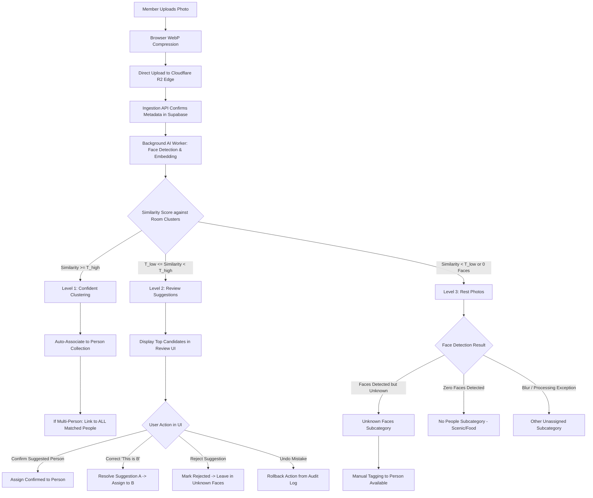

# System Flow & Lifecycles

This document outlines the end-to-end operational lifecycles of ChobiDeh, specifying the Three-Level Photo Matching, Review Suggestions, and Rest Photos workflows.

---

## 1. High-Level System Architecture Flow

---

## 2. Detailed Lifecycle Workflows

### Flow 1: Upload & Direct Storage (Zero-Server Proxying)
1. User selects 1 to 50 photos in a room.
2. The browser automatically compresses each image to high-resolution 2K WebP (~400 KB) using HTML5 Canvas.
3. The client calls `POST /api/rooms/:roomId/photos/upload-intent` with file metadata.
4. The server validates room membership and ensures the room has not exceeded **1,000 photos**.
5. Server returns a short-lived S3 pre-signed `PUT` URL for Cloudflare R2.
6. The browser uploads the binary file directly to R2 edge.
7. The browser calls `POST /api/rooms/:roomId/photos/confirm` to persist metadata in PostgreSQL.

---

### Flow 2: Level 1 Confident Matching (Multi-Person Group Photos)
1. AI worker extracts face embeddings for detected faces in the photo.
2. For each face, cosine similarity is computed against existing room person clusters.
3. If similarity $\ge T_{\text{high}}$ (e.g. 0.82):
   - The face instance is assigned to that person's cluster.
   - If **Person A (Tasnim)** and **Person B (Rafiqul)** are both detected with high confidence in the same photo:
     - Row 1: `photo_assignments (media_id, cluster_tasnim)`
     - Row 2: `photo_assignments (media_id, cluster_rafiqul)`
   - When Tasnim views her collection, the photo appears.
   - When Rafiqul views his collection, the photo appears.
   - **Crucial Rule:** The original photo file is stored **only once** in R2.

---

### Flow 3: Level 2 Review Suggestions & Correction (A → B)
1. If similarity is marginal ($0.65 \le \text{Similarity} < 0.82$):
   - AI flags the face as an **Uncertain Match**.
   - Creates a row in `public.uncertain_matches` with `candidate_clusters` listing the closest candidates.
   - **Rule:** Never assign automatically.
2. The photo appears in the room's **Review Suggestions** section.
3. An authorized room member inspects the suggestion:
   - **Case A (Confirm):** User clicks "Confirm Rafiqul".
     - `uncertain_matches.status` $\rightarrow$ `'confirmed'`.
     - Confirmed row created in `photo_assignments`.
   - **Case B (Correct A → B):** AI suggested Person A (Tasnim), but the user sees it is Person B (Samira).
     - User selects "This is Samira".
     - System resolves/removes the suggestion for Tasnim.
     - Confirmed assignment created for Samira.
     - Logged in `assignment_history` with `previous_cluster: Tasnim, new_cluster: Samira`.
   - **Case C (Reject):** User clicks "Reject".
     - System marks `uncertain_matches.status` $\rightarrow$ `'rejected'`.
     - **Rule:** Never treat a rejection alone as proof that someone else is the match. The photo stays in Level 3 *Unknown Faces*.
   - **Case D (Undo):** User accidentally clicked the wrong button.
     - User clicks "Undo Last Action".
     - System reads `assignment_history` and rolls back the assignment to `pending_review`.

---

### Flow 4: Level 3 Rest Photos Categorization
1. Photos not confidently assigned to any person are routed to **Rest Photos**.
2. Categorized into three dedicated, mutually exclusive filters:
   - **Unknown Faces:** Human faces detected, but unmatched. Users can tap a face crop and click **"Tag Person"** to manually assign.
   - **No People:** Scenery, sunsets, beach landscapes, food, monuments with zero detected faces.
   - **Other Unassigned:** Blurred shots, low light, or processing exceptions.

---

### Flow 5: Dual Export (Save to Phone & Google Drive)
1. **Save to Phone:** User clicks "Download All" $\rightarrow$ Client bundles photos into a single `.zip` file in the browser and triggers direct download.
2. **Export to Google Drive:** User clicks "Export to Google Drive" $\rightarrow$ Server copies photos cloud-to-cloud into the user's personal Google Drive folder (`ChobiDeh - [Room Name]`) using the non-sensitive `drive.file` scope.
